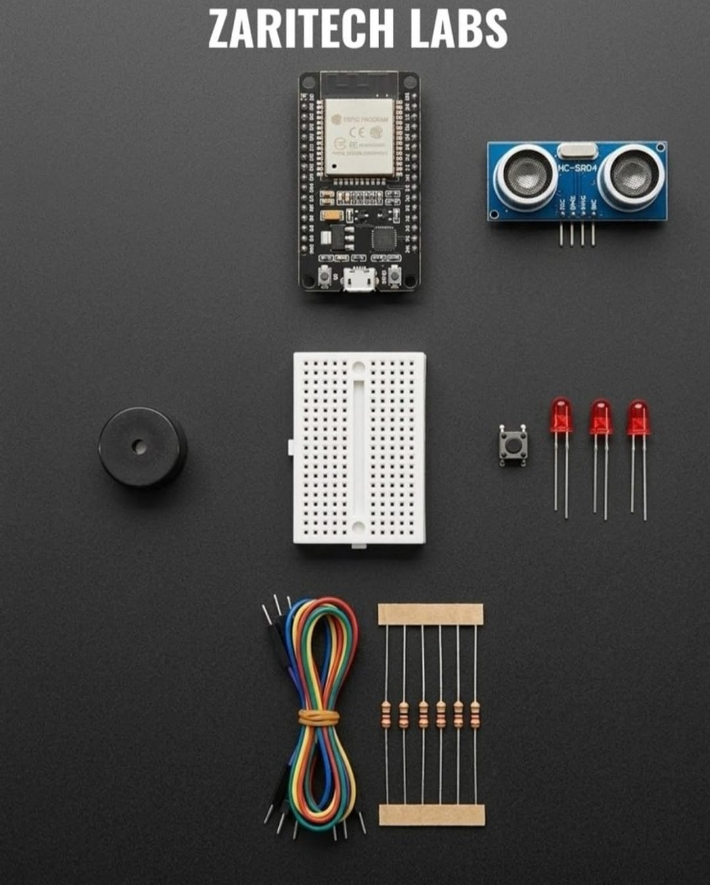

# Zaritech ESP32 Spatial Telemetry & Ultrasonic Radar Ecosystem 🌐📡

Welcome to the official repository for the **Zaritech ESP32 Spatial Telemetry Suite** — a high-performance edge-computing proximity tracking platform engineered by **Zaritech Labs** (A division of **Zaritech Dynamics**).

This infrastructure leverages the advanced processing capabilities of the 32-bit dual-core ESP32 architecture coupled with precision ultrasonic time-of-flight telemetry. Designed for industrial automation safety zones, autonomous robotics mapping, and contactless human-machine validation, this ecosystem models real-time distance metrics and triggers instant localized defensive behaviors.

---

## 🛠️ Hardware & Topology Specs
Our specialized spatial computing platform consolidates high-frequency telemetry tracking, active signaling nodes, and rigid prototyping interfaces:

*   **Core Microcontroller:** ESP32 NodeMCU Development Board featuring a high-performance 32-bit dual-core processor, integrated Wi-Fi/Bluetooth, and rich peripheral structures.
*   **Spatial Telemetry Node:** HC-SR04 Ultrasonic Distance Sensor utilizing precise sonic pulse time-of-flight mapping for non-contact distance diagnostics.
*   **Human Interface & Trigger Node:** 1x Premium Tactile Push Button Switch for manual overrides, mode switching, or localized calibration sequencing.
*   **Visual Notification Array:** 3x Industrial Grade Red Status LEDs for tiered physical proximity alerts and diagnostic signaling strings.
*   **Acoustic Signal Unit:** High-resonance Active Buzzer providing multi-level frequency alarms and critical warning thresholds.
*   **Interconnect Substrate:** High-durability Mini Breadboard layout paired with a factory-verified premium mix jumper wire array for secure signal paths.
*   **Passive Component Array:** 5x Precision Current-Limiting Resistors optimized for safeguarding signal paths across the LED array and control loops.

---

## 🗺️ Visual Architecture & Pin Topology
The comprehensive hardware mapping, unified pin distributions, and signal lines for this ESP32 ecosystem are detailed inside this core matrix:

### Core Interconnection Routing Matrix

| Component Module | Peripheral Node | ESP32 GPIO Node | Operational Context |
| :--- | :--- | :--- | :--- |
| **HC-SR04 Sensor** | VCC / GND | 5V (VIN) / GND | Main Logic Power Rail |
| | Trigger Pin | GPIO 5 | Sonic Pulse Transmission Output |
| | Echo Pin | GPIO 18 | Time-of-Flight Return Input |
| **Active Buzzer Alert** | Positive (+) Signal | GPIO 19 | Threshold Alarm Trigger Array |
| **Tactile Push Switch**| Input Contact | GPIO 4 (Pull-Up) | System Manual Calibration Input |
| **Visual LED Array** | LED 1 / 2 / 3 (Anodes) | GPIO 25 / 26 / 27 | Cascade Status Warning Displays |

### Industrial Firmware Implementation
The full, modular multi-layered firmware solution supporting automated distance calculations, hardware interrupt handling, and real-time localized dashboard routing is safely separated into our production codebase.

🔗 **[Click here to view the full operational source code](./firmware/zaritech_spatial_radar.ino)**

---

## 📸 Hardware Layout

---

## 📥 Commercial Acquisition & Distribution
To purchase factory-certified **Zaritech ESP32 Spatial Telemetry Suites**, standalone ultrasonic sensor strings, or to request custom automation firmwares, please connect with our global distribution network through our official [Zaritech Labs Instagram](https://instagram.com).

---

## ⚖️ License & Governance
This infrastructure is maintained under the **MIT License** and governed under the rigorous engineering frameworks of **Zaritech Dynamics**.

*May Allah grant us success on this path.*
