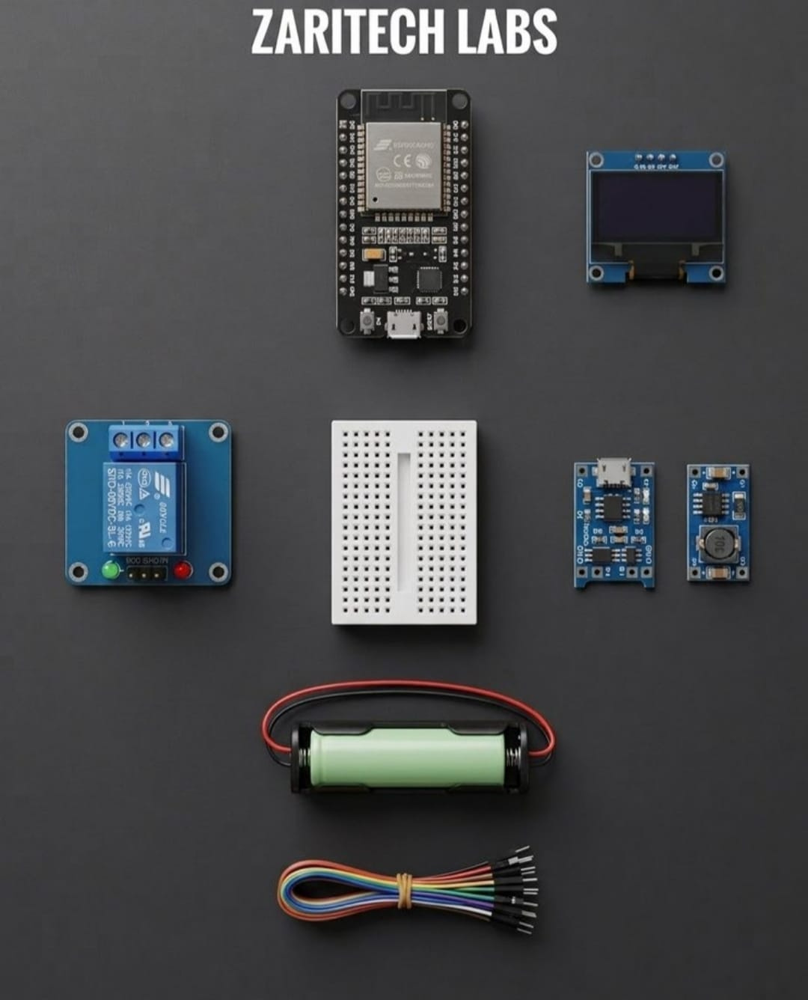

# Zaritech ESP32 Uninterruptible IoT Gateway & OLED Automation Node 🌐🔋

Welcome to the official repository for the **Zaritech Uninterruptible IoT Gateway Platform** — an industrial-grade, battery-backed automation smart hub engineered by **Zaritech Labs** (A division of **Zaritech Dynamics**).

### ⚡ The Problem: Mission-Critical Failure
Standard smart home systems rely entirely on stable grid power. During an electrical blackout or sudden power grid collapse, conventional edge-computing devices drop offline, completely disabling security automation and remote telemetry lines.

### 🛡️ The Zaritech Solution: Zero-Down-Time Grid Independence
This platform integrates a dedicated **Continuous Energy Storage Substrate (Uninterruptible Power Supply / UPS)** directly into the dual-core ESP32 wireless infrastructure. By merging active charging paths and precise boost regulation, the central automation hub keeps communicating, controlling relays, and refreshing telemetry dashboard servers even during complete external power failures.

---

## 🛠️ Hardware & Topology Specs
Our mission-critical smart node combines high-frequency processing, real-time visual infrastructure, and advanced power management topologies:

*   **Core Microcontroller Unit:** ESP32 NodeMCU Development Board with high-frequency 32-bit dual-core processing, native Wi-Fi/Bluetooth stacks, and asynchronous thread capabilities.
*   **Visual Telemetry Subsystem:** 0.96" I2C OLED Display (SSD1306 Architecture) for localized diagnostic rendering, active IP address visualization, and real-time state-of-charge monitoring.
*   **Power Harvesting & Battery Management (PMIC Stack):**
    *   **TP4056 Lithium Charging Infrastructure:** High-efficiency, thermal-regulated linear charger for safe handling of high-capacity cells.
    *   **High-Frequency Synchronous Boost Topology:** Integrated step-up conversion network (SX1308/Alternate High-Current Substrates) optimized to cleanly step up cell voltages to a stable 5V logic line.
    *   **Zaritech Energy Cell:** 1x Factory-Verified 18650 High-Capacity Lithium-Ion Cell paired with a low-resistance rigid cell dock (Complimentary Gift Layer).
*   **Actuation & Load Routing:** 5V Heavy-Duty Isolated Relay Module supporting up to **10A (250VAC / 30VDC)** synchronous switching grids.
*   **Interconnect Substrate:** Factory-verified premium mix jumper wire array accompanied by a high-durability medium breadboard framework.

---

## 🗺️ Visual Architecture & Pin Topology
The comprehensive hardware mapping, unified I2C bus routes, and power delivery architecture for this uninterruptible system are detailed below:

### Core Interconnection Routing Matrix

| Component Module | Peripheral Node | ESP32 GPIO Node | Operational Context |
| :--- | :--- | :--- | :--- |
| **0.96" OLED Display** | VCC / GND | 3V3 / GND | Low-Power Logic Power Rail |
| | SDA (Serial Data) | GPIO 21 | I2C Telemetry Data Stream |
| | SCL (Serial Clock) | GPIO 22 | I2C Hardware Clock Synchronization |
| **5V Isolated Relay** | IN Control Signal | GPIO 14 (D5) | Mission-Critical Load Actuation |
| **Power Booster Node** | VOUT+ / VOUT- | VIN / GND | 5V Stable Backed-Up Power Input |

### Industrial Firmware Implementation
The full, multi-threaded firmware solution managing asynchronous OLED screen updates, localized responsive HTML web servers, and wireless status broadcasts is cleanly separated into our production codebase.

🔗 **[Click here to view the full operational source code](./firmware/zaritech_uninterruptible_hub.ino)**

---

## 📸 Hardware Layout

---

## 📥 Commercial Acquisition & Distribution
To purchase factory-certified **Zaritech Uninterruptible IoT Gateway Platforms**, standalone PMIC modules, or to order industrial battery configurations, please interface with our international supply network via our official [Zaritech Labs Instagram](https://instagram.com).

---

## ⚖️ License & Corporate Governance
This infrastructure is maintained under the **MIT License** and governed under the rigorous engineering frameworks of **Zaritech Dynamics**.

*May Allah grant us success on this path.*
