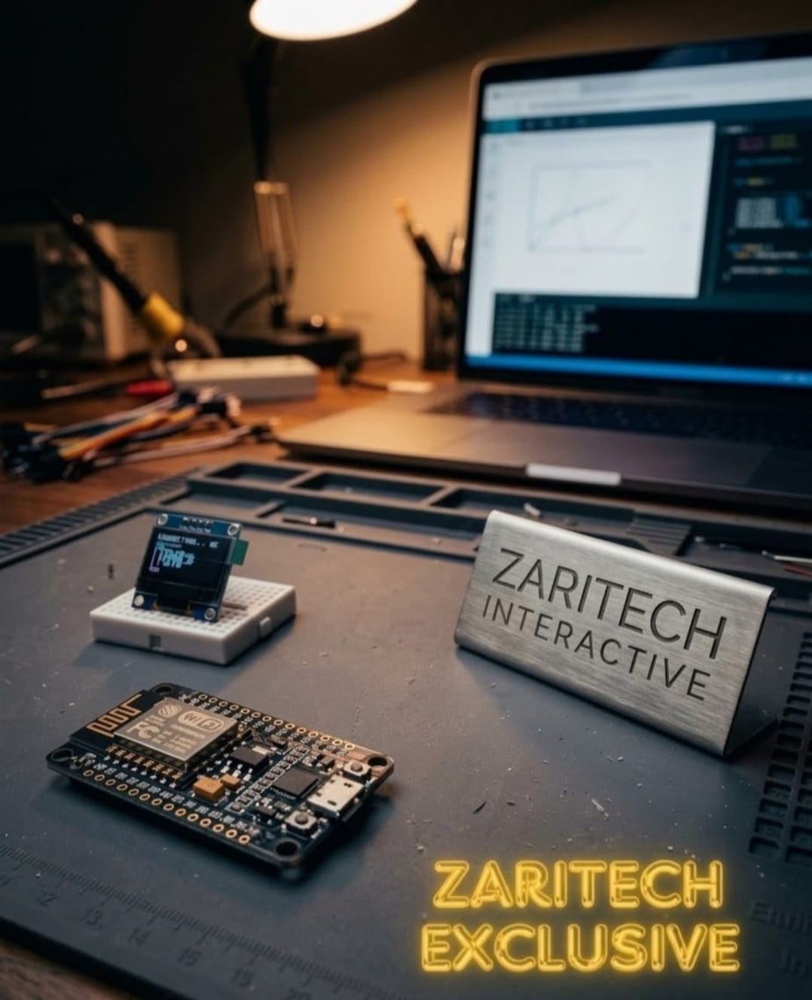

# Zaritech Exclusive High-Performance IoT Module & Wireless OLED Node 🌐✨

Welcome to the official repository for the **Zaritech Exclusive IoT Module Platform** — a high-reliability, developer-centric interaktif wireless system engineered by **Zaritech Interactive** (A division of **Zaritech Dynamics**).

### ⚡ The Problem: Breadboard Pin Starvation
Standard NodeMCU form-factors present a major layout flaw during physical prototyping: when plugged directly into conventional medium or mini breadboards, the wide structural substrate completely obscures the underlying contact strips. This "pin starvation" prevents developers from safely routing interconnect lines, leading to unstable jumper stacks, signal noise, and slower prototyping lifecycles.

### 🛡️ The Zaritech Solution: External Brain & Custom Link Architecture
The **Zaritech Exclusive Series** solves this bottleneck completely. By decoupling the NodeMCU microcontroller from the local breadboard substrate and treating it as an independent external core, this module retains full operational flexibility. Signal lines are cleanly bridged to the high-durability mini prototyping breadboard using our bespoke **"Male-to-Female Custom Pinout Wire Array"**, ensuring an uninhibited footprint dedicated entirely to the 0.96" I2C OLED sub-system.

---

## 🛠️ Hardware & Topology Specs
Our exclusive development module is optimized for high-speed live data streaming, clean signal paths, and low-latency local network interfaces:

*   **Core Microcontroller Node:** NodeMCU ESP8266 high-frequency wireless processing chip operating on a stable 32-bit architecture with native TCP/IP protocols.
*   **Visual Interface Display:** 0.96-inch High-Contrast I2C OLED Screen (SSD1306 Controller) optimized for text rendering, frame buffers, and localized telemetry reporting.
*   **Decoupled Substrate Array:** 1x High-Durability Mini Prototyping Breadboard serving as an unhindered terminal node specifically for peripheral sensors and screen layouts.
*   **Interconnect Infrastructure:** Exclusive Premium Jumper Wire Array featuring custom male-to-female logic paths to seamlessly execute the external brain topology without signal distortion.

---

## 🗺️ Visual Architecture & Pin Topology
The clean hardware mapping, dedicated I2C communication channels, and logic paths for this exclusive architecture are documented below:

### Central Interconnection Matrix

| Physical Sub-System | Hardware Node Pin | NodeMCU Node Pin | Operational Logic Context |
| :--- | :--- | :--- | :--- |
| **0.96" OLED Display** | VCC | 3V3 | Safe Logic Power Supply Rail |
| | GND | GND | Ground Reference Plane |
| | SDA (Serial Data) | D2 (GPIO4) | Dedicated I2C Data Routing Channel |
| | SCL (Serial Clock) | D1 (GPIO5) | High-Frequency I2C Clock Line |

### Industrial Firmware Implementation
The standalone, production-ready source code driving wireless packet routing, responsive HTML visual dashboards, and localized OLED state rendering is isolated within our verified code repository.

🔗 **[Click here to view the full operational source code](./firmware/zaritech_exclusive_oled.ino)**

---

## 📸 Hardware Layout

---

## 📥 Commercial Acquisition & Distribution
To procure enterprise-grade **Zaritech Exclusive High-Performance IoT Modules**, tailored custom cable arrays, or to request dedicated wireless gateway firmware adaptations, please coordinate with our supply division via our official [Zaritech Labs Instagram](https://instagram.com).

---

## ⚖️ License & Corporate Governance
This infrastructure is maintained under the **MIT License** and governed under the rigorous engineering frameworks of **Zaritech Dynamics**.

*May Allah grant us success on this path.*
