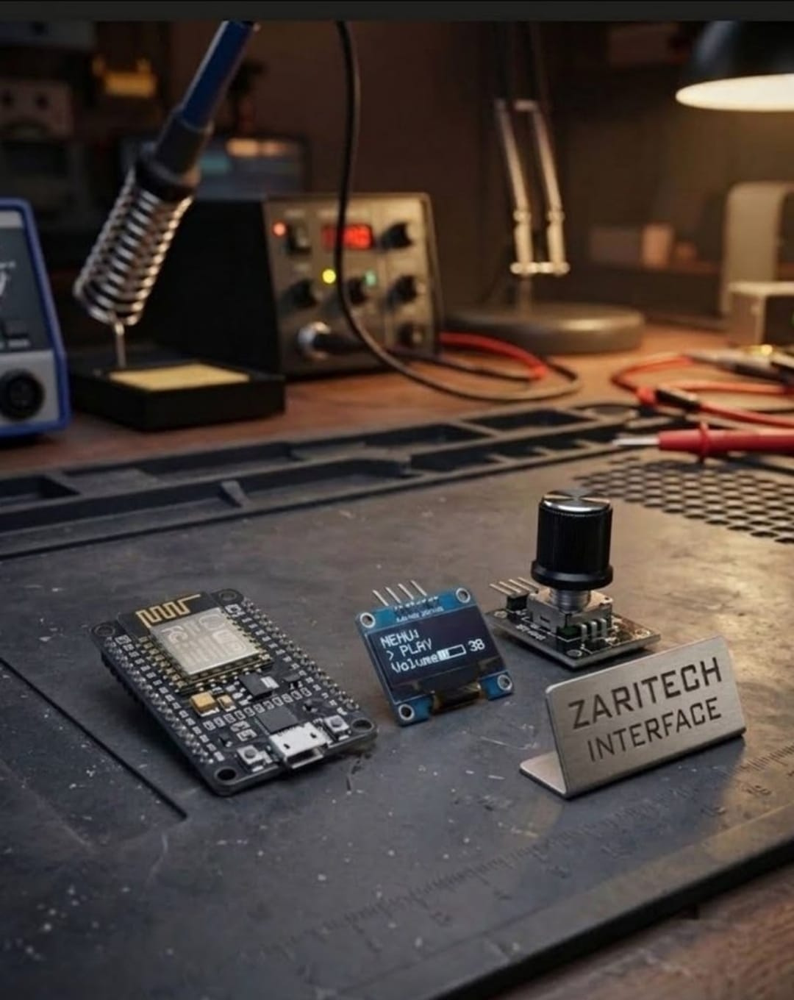

# Zaritech Industrial HMI Rotary Menu System & OLED Interface 🌐⚙️

Welcome to the official repository for the **Zaritech Industrial HMI Rotary Menu System** — a high-reliability, interactive human-machine control interface engineered by **Zaritech Labs** (A division of **Zaritech Dynamics**).

### ⚡ The Problem: Interface Complexity & Button Fatigue
Conventional micro-controller interfaces often rely on sprawling matrices of tactile push-buttons for data entry, password submission, or menu navigation. This introduces high hardware clutter, increased failure points due to mechanical debounce, and an unpolished user experience unsuited for professional automation panels.

### 🛡️ The Zaritech Solution: Unified Rotary Encoder & Asynchronous OLED Navigation
The **Zaritech HMI Module** replaces complex component arrays with a single, high-durability **Rotary Encoder Subsystem**. Operating on an active quadrature pulse string with an integrated hardware switch, this module allows users to smoothly browse multi-tier software menus, calibrate operational thresholds, and submit wireless access tokens. Paired with a high-contrast 0.96" OLED panel, it turns the NodeMCU processor into an industrial control hub.

---

## 🛠️ Hardware & Topology Specs
Our advanced human-machine interface platform is optimized for precise step tracking, high-speed menu buffering, and immediate haptic logic feedback:

*   **Core Microcontroller Unit:** NodeMCU ESP8266 high-frequency 32-bit wireless processing node executing custom low-latency UI threads.
*   **Haptic Control Actuator:** Full 360-degree Rotary Encoder Module featuring distinct detent feedback, precise quadrature outputs (CLK/DT), and an integrated momentary push-button switch (SW).
*   **Visual Interface Core:** 0.96-inch High-Contrast I2C OLED Screen (SSD1306 Architecture) for layout rendering, parameter tracking, and interactive dashboards.
*   **Interconnect Infrastructure:** Factory-verified premium jumper wire array optimized to guarantee clean logic paths and prevent signal degradation on fast encoder clock pulses.

---

## 🗺️ Visual Architecture & Pin Topology
The hardware routing grid, dedicated hardware interrupt pins, and communication lines for this HMI node are detailed inside this central matrix:

### Central Interconnection Matrix

| Sub-System Node | Component Pin Name | NodeMCU Node Pin | Operational Logic Context |
| :--- | :--- | :--- | :--- |
| **0.96" OLED Display** | VCC / GND | 3V3 / GND | Low-Power Logic Rail |
| | SDA / SCL | D2 / D1 | I2C Telemetry Control Lines |
| **Rotary Encoder** | CLK (Clock Pulse) | D5 (GPIO14) | Quadrature Interrupt Channel A |
| | DT (Data Pulse) | D6 (GPIO12) | Quadrature Interrupt Channel B |
| | SW (Push Button) | D7 (GPIO13) | Menu Execution / Select Switch |

### Industrial Firmware Implementation
The full, modular multi-layered firmware solution executing digital debounce, quadrature pulse tracking, nested menu arrays, and local Wi-Fi state broadcast is safely separated into our production codebase.

🔗 **[Click here to view the full operational source code](./firmware/zaritech_hmi_menu.ino)**

---

## 📸 Hardware Layout

---

## 📥 Commercial Acquisition & Distribution
To purchase factory-certified **Zaritech Industrial HMI Rotary Menu Systems**, specialized encoder integration units, or to request custom web-connected menu templates, please synchronize with our corporate distribution network through our official [Zaritech Labs Instagram](https://instagram.com).

---

## ⚖️ License & Corporate Governance
This infrastructure is maintained under the **MIT License** and governed under the rigorous engineering frameworks of **Zaritech Dynamics**.

*May Allah grant us success on this path.*
