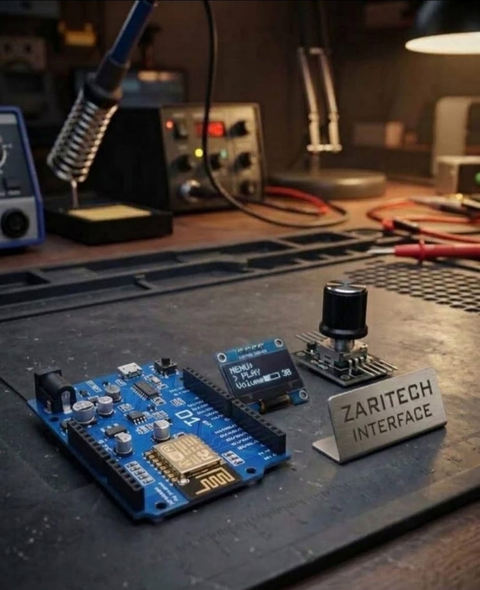

# Zaritech UniPro Wireless Desktop Assistant & Live Telemetry Node 🌐⚙️

Welcome to the official repository for the **Zaritech UniPro Wireless Desktop Assistant** — a high-efficiency network-connected smart monitoring substrate engineered by **Zaritech Labs** (A division of **Zaritech Dynamics**).

### ⚡ The Problem: Prototyping Friction & Wire Clutter
Building compact internet-of-things desktop appliances often requires dealing with unstable, shifting component bundles on traditional breadboards. Loose connections, accidental pin disengagements, and complex point-to-point jumpers increase system noise and development overhead during real-time network stress tests.

### 🛡️ The Zaritech Solution: Unified Form-Factor Integration
The **Zaritech UniPro Suite** eliminates prototyping friction by leveraging a rugged **Wemos D1 R2 Form-Factor Substrate**. This design provides a rigid mechanical and electrical backplane out of the box. By routing high-speed SPI/I2C communication channels natively over secure jumper runs directly to the 0.96" High-Resolution OLED panel and Rotary encoder matrix, makers can deploy live weather stations, digital synchronized chronometers, and desktop assistants in minutes without a single drop of solder.

---

## 🛠️ Hardware & Topology Specs
Our desktop edge telemetry platform is optimized for seamless network synchronizations, compact desk footprints, and crisp user interfaces:

*   **Core Microcontroller Unit:** Wemos D1 R2 (Arduino-Uno Footprint) high-frequency 32-bit Wi-Fi development board combining legacy shields layout with modern ESP8266 network processing pipelines.
*   **Visual Subsystem Array:** 0.96-inch High-Resolution I2C OLED Screen (SSD1306 Architecture) calibrated for telemetry rendering, live font matrices, and diagnostic loading animations.
*   **Haptic Interface Element:** 360-degree Rotary Encoder Subsystem with click-to-select functionality for localized data manipulation and menu switching.
*   **Interconnect Substrate:** Factory-verified premium jumper wire matrix engineered to secure stable data streams under continuous high-frequency operation.

---

## 🗺️ Visual Architecture & Pin Topology
The streamlined hardware signal pathways, shared I2C bus nodes, and control triggers for this desktop system are logged below:

### Core Interconnection Routing Matrix

| Peripheral Node | Component Pin Name | Wemos D1 R2 Interface Node | Operational Logic Context |
| :--- | :--- | :--- | :--- |
| **0.96" OLED Screen** | VCC / GND | 3V3 / GND | Low-Voltage Local Power Rail |
| | SDA (Serial Data) | D2 (GPIO4) | Main I2C Data Telemetry Channel |
| | SCL (Serial Clock) | D1 (GPIO5) | Main I2C System Hardware Clock |
| **Rotary Encoder** | CLK / DT | D5 / D6 | Asynchronous Navigation Inputs |
| | SW (Switch Input) | D7 (GPIO13) | Mode Selection / Action Commits |

### Industrial Firmware Implementation
The standalone production firmware layer orchestrating NTP time server handshakes, live weather JSON payload parsing, and low-latency menu rendering buffers is safely isolated inside our specialized source code repository.

🔗 **[Click here to view the full operational source code](./firmware/zaritech_unipro_assistant.ino)**

---

## 📸 Hardware Layout

---

## 📥 Commercial Acquisition & Distribution
To buy factory-certified **Zaritech UniPro Wireless Desktop Assistant Modules**, auxiliary sensor packages, or to license custom smart assistant backend firmwares, please interface with our international logisitic division via our official [Zaritech Labs Instagram](https://instagram.com).

---

## ⚖️ License & Corporate Governance
This infrastructure is maintained under the **MIT License** and governed under the rigorous engineering frameworks of **Zaritech Dynamics**.

*May Allah grant us success on this path.*
