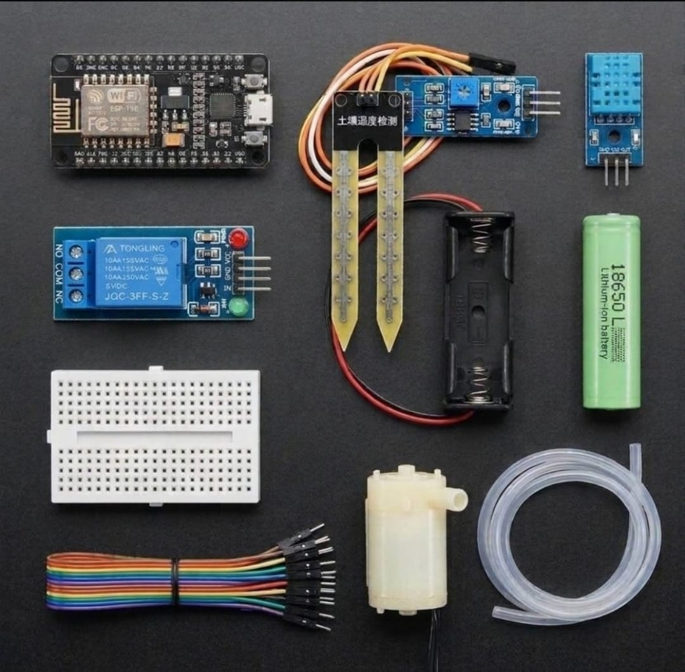

# Zaritech Precision Smart-Agriculture Hub & Automated Irrigation Substrate 🌐🌱

Welcome to the official repository for the **Zaritech Precision Smart-Agriculture Hub** — a high-efficiency wireless automated irrigation and micro-climate management ecosystem engineered by **Zaritech Labs** (A division of **Zaritech Dynamics**).

### ⚡ The Problem: Linear Irrigation Failure
Traditional agricultural setups rely on blind, scheduled watering timers. They fail to adapt to real-time micro-climate shifts, soil moisture depletion, or sudden ambient evaporation drops. This results in root rot, massive water resource wastage, and soil mineralization, causing significant plant degradation.

### 🛡️ The Zaritech Solution: Closed-Loop Soil Moisture Feedback & Fluid Actuation
The **Zaritech Smart-Agriculture Platform** introduces an autonomous, telemetry-driven feedback loop. By combining a resistive **Soil Moisture Sensor Array** and a digital **DHT11 Environmental String Sensor** into the 32-bit NodeMCU core, the gateway constantly measures subterranean and atmospheric parameters. When soil moisture drops below critical biological thresholds, the node fires an isolated 5V micro-submersible fluid pump to execute precision watering, while simultaneously broadcasting real-time metrics over a standalone HTML server dashboard.

---

## 🛠️ Hardware & Topology Specs
Our mission-critical precision farming substrate is engineered for dual-zone telemetry capture, isolated fluid dynamics, and grid-independent power distribution:

*   **Core Processing Unit:** NodeMCU V3 ESP8266 high-frequency wireless controller executing multi-layered telemetry parsing and local server stacks.
*   **Subterranean Telemetry Node:** Resistive Soil Moisture Sensor Array with an integrated comparator module for real-time volumetric water content calculations.
*   **Atmospheric Sensory String:** DHT11 Digital Temperature and Humidity Sensor calibrated for precise ambient climate metrics.
*   **Fluid Actuation Subsystem:** 5V Mini Submersible Water Pump paired with high-durability flexible silicone fluid transport tubing.
*   **Isolation & Power Routing Layer:** 1V Single-Channel Relay Module supporting true **10A (250VAC / 30VDC)** synchronous switching grids to safeguard logic lines from pump back-EMF spikes.
*   **Autonomous Energy Substrate:** 1x Factory-Verified High-Capacity 18650 Lithium-Ion Battery Node with a low-resistance single cell dock (Complimentary Expansion Layer).
*   **Interconnect Matrix:** High-durability Mini Prototyping Breadboard paired with a 20-piece premium color-coded jumper wire array for secure signal paths.

---

## 🗺️ Visual Architecture & Pin Topology
The streamlined hardware signal pathways, shared bus lines, and output triggers for this agricultural ecosystem are detailed below:

### Central Interconnection Matrix

| Sub-System Node | Component Pin Name | NodeMCU Node Pin | Operational Logic Context |
| :--- | :--- | :--- | :--- |
| **Soil Moisture Sensor** | VCC / GND | 3V3 / GND | Low-Power Logic Power Rail |
| | Analog Output (AO) | A0 (ADC0) | Voltaric Subterranean Telemetry |
| **DHT11 Sensor** | DATA (Signal Out) | D4 (GPIO2) | Single-Bus Climate Data Stream |
| **5V Isolated Relay** | IN Control Signal | D1 (GPIO5) | Fluid Pump Actuation Switch |
| **Mini Water Pump** | Positive (+) / Ground (-) | Relay NO / GND | Backed-Up Fluid Delivery Path |

### Industrial Firmware Implementation
The full, modular multi-layered firmware solution executing analog parsing pipelines, automated moisture boundary control, and responsive wireless server dashboard rendering is safely isolated within our production codebase.

🔗 **[Click here to view the full operational source code](./firmware/zaritech_agricultural_irrigation.ino)**

---

## 📸 Hardware Layout

---

## 📥 Commercial Acquisition & Distribution
To purchase factory-certified **Zaritech Precision Smart-Agriculture Hubs**, replacement submersible fluid arrays, or to request customized commercial greenhouse telemetry firmwares, please synchronize with our international logistic network via our official [Zaritech Labs Instagram](https://instagram.com).

---

## ⚖️ License & Corporate Governance
This infrastructure is maintained under the **MIT License** and governed under the rigorous engineering frameworks of **Zaritech Dynamics**.

*May Allah grant us success on this path.*
