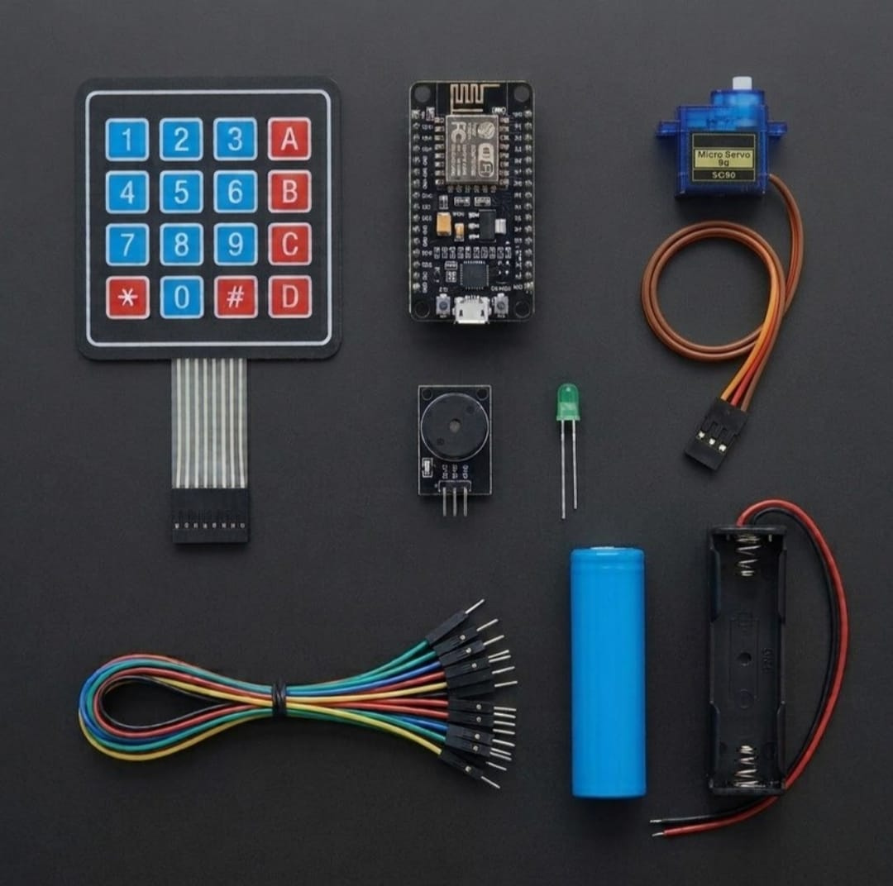

# Zaritech Secure Matrix Access Control & Servo Actuation Framework 🌐🔒

Welcome to the official repository for the **Zaritech Secure Matrix Access Control Hub** — a high-reliability, edge-computing physical validation and perimeter security ecosystem engineered by **Zaritech Labs** (A division of **Zaritech Dynamics**).

### ⚡ The Problem: Vulnerable Physical Entry Overrides
Conventional mechanical locking systems lack digital audit trails, remote override mechanics, and multi-tier authentication parameters. When deploying standalone digital safes or industrial access panels, mechanical keyway vulnerabilities and heavy dependency on main grid networks increase the overall security threat profile.

### 🛡️ The Zaritech Solution: Decoupled Cryptographic Matrix Verification & Servo Lock
The **Zaritech Access Control Hub** establishes an advanced layer of perimeter defense. By combining a 16-button **4x4 Keypad Entry Matrix**, an acoustic diagnostics **Active Buzzer Array**, and a high-precision **SG90 Micro Servo Actuator** into the NodeMCU wireless core, the platform governs high-security entry tasks. Correct cryptographic tokens actuate the servo mechanism to release secure latches, while unauthorized brute-force attempts immediately trigger acoustic strobe behaviors and broadcast telemetry logs to a remote network server.

---

## 🛠️ Hardware & Topology Specs
Our mission-critical physical security substrate is optimized for secure matrix column scanning, fast lock duty-cycles, and un-tethered operational continuity:

*   **Core Processing Unit:** NodeMCU V3 ESP8266 high-frequency wireless controller managing row-column state registers and precise PWM frequency outputs.
*   **HMI Access Matrix:** 4x4 High-Durability Membran Keypad tracking 16 discrete input nodes over a multiplexed 8-pin digital logic interface.
*   **Mechanical Actuation Node:** SG90 Micro Servo Motor executing high-reliability 0-to-180 degree mechanical physical block and release actions via dedicated PWM timing pulses.
*   **Acoustic Telemetry Subsystem:** Active Buzzer Module for immediate haptic key-press acknowledgement, success signaling, and localized alert strokes.
*   **Visual State Indicator:** 1x Current-Limiting Green Status LED serving as a diagnostic baseline for verified security authorization paths.
*   **Autonomous Energy Substrate:** 1x Factory-Verified High-Capacity 18650 Battery Node with a low-resistance single cell dock (Complimentary Security Standby Layer).
*   **Interconnect Infrastructure:** 20-piece premium high-durability jumper wire array calibrated for noise-free matrix communications.

---

## 🗺️ Visual Architecture & Pin Topology
The streamlined hardware signal pathways, shared bus lines, and input-output registers for this access control framework are detailed below:

### Central Interconnection Matrix

| Sub-System Node | Component Pin Name | NodeMCU Node Pin | Operational Logic Context |
| :--- | :--- | :--- | :--- |
| **4x4 Keypad Matrix** | Rows 1 - 4 | D0 / D1 / D2 / D3 | Input Matrix Row Scanning Bus |
| | Columns 1 - 4 | D4 / RX / TX / D8 | Input Matrix Column Return Registers |
| **SG90 Micro Servo** | PWM Signal Line | D5 (GPIO14) | High-Precision Angular Actuation Pulse |
| **Active Buzzer** | Positive (+) Signal | D6 (GPIO12) | Acoustic Alarm Strobe Output |
| **Green Status LED** | Anode (+) Lead | D7 (GPIO13) | Security Authorization Visual Pin |

### Industrial Firmware Implementation
The full, modular multi-layered firmware solution executing debounced keypad matrix parsing, safe PWM position hold loops, and responsive remote administration dashboards is safely isolated within our production codebase.

🔗 **[Click here to view the full operational source code](./firmware/zaritech_secure_lock.ino)**

---

## 📸 Hardware Layout

---

## 📥 Commercial Acquisition & Distribution
To purchase factory-certified **Zaritech Secure Matrix Access Control Hubs**, reinforced servo mechanism brackets, or to license remote corporate telemetry firmware templates, please coordinate with our logistics network via our official [Zaritech Labs Instagram](https://instagram.com).

---

## ⚖️ License & Corporate Governance
This infrastructure is maintained under the **MIT License** and governed under the rigorous engineering frameworks of **Zaritech Dynamics**.

*May Allah grant us success on this path.*
