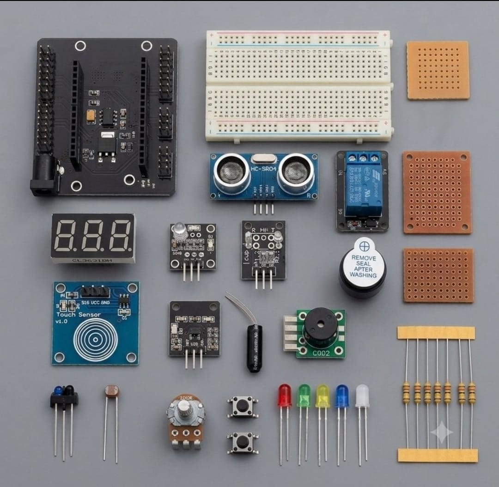

# Zaritech UniPro Sensor Fusion Complex & Multi-Tier IoT Gateway 🌐⚡

Welcome to the official repository for the **Zaritech UniPro Sensor Fusion Complex** — the ultimate flagship development substrate and mission-critical multi-sensor validation ecosystem engineered by **Zaritech Labs** (A division of **Zaritech Dynamics**).

### ⚡ The Problem: Prototyping Gridlock & Sensor Interconnection Noise
When building high-density IoT frameworks that concurrently monitor human biometrics, mechanical tilt variations, and acoustic warning thresholds, traditional single-breadboard layouts inevitably fail. Multiplexing over twenty unique sensor pins introduces capacitive crosstalk, unstable ground planes, wire degradation, and severe physical layout constraints that freeze manufacturing and testing lifecycles.

### 🛡️ The Zaritech Solution: Integrated Base Shield Topology & Hardware Fusion
The **Zaritech Sensor Fusion Complex** resolves this architectural bottleneck. By pairing our high-frequency wireless core with an integrated heavy-duty **Base Shield Backplane**, all logic and power lines are routed over dedicated, structurally sound interconnect lanes. This flagship system consolidates multi-axis physical orientation tracking, infrared telemetry lines, capacitive touch panels, and raw biometric pulse captures under a unified asynchronous firmware mesh.

---

## 🛠️ Hardware & Topology Specs
Our ultimate IoT engineering laboratory features a rich peripheral sensor array, isolated power tracks, and permanent prototype soldering options:

*   **Core Wireless Controller Hub:** High-frequency 32-bit Wi-Fi development engine seated on an industrial **Zaritech Multi-IO Base Shield** to bypass breadboard constraints.
*   **Biometric & Atmospheric Sensors:**
    *   **KY-039 Heartbeat / Pulse Subsystem:** Infrared phototransistor array for localized pulse telemetry.
    *   **5mm Balanced LDR Sensor Node:** High-sensitivity ambient luminance tracking.
*   **Kinematic & Spatial Security Array:**
    *   **HC-SR04 Ultrasonic Telemetry Strings:** Precision non-contact sonic distance metrics.
    *   **SW-520D Tilt Switch & KY-031 Impact Sensors:** Mechanical tilt and multi-axis vibrational telemetry vector analysis.
    *   **TCRT5000 Infrared Reflective Node:** High-accuracy optical tracking and surface contrast detection.
*   **Actuation, Acoustic & HMI Modules:**
    *   **TTP223/B Capacitive Touch Array:** Wear-free, low-latency digital solid-state human input interfaces.
    *   **5V Isolated Relay Module:** True **10A (250VAC / 30VDC)** grid switching architecture.
    *   **C002 Active Siren Modül & 5V High-Resonance Buzzer:** Dual-tiered acoustic warning grids.
*   **Visual Indicators & Prototyping Substrates:**
    *   **3-Digit 7-Segment Display Array:** Localized high-visibility data and numeric state reporting.
    *   **RGB Full-Color LED Module:** Multi-state fluid color diagnostic outputs.
    *   **Substrate Kit:** 1x Medium Prototyping Breadboard, 1x 5x5 Rigid Pertinax Substrate, 1x 6x4 Prototyping Board for permanent component mounting.

---

## 🗺️ Visual Architecture & Pin Topology
The flagship hardware signal matrix and multi-bus routing parameters for this master complex are detailed below:

### Central Master Interconnection Matrix

| Sensor / Module Group | Specific Component | Target MCU GPIO | Operational Domain Context |
| :--- | :--- | :--- | :--- |
| **HMI Input Subsystems** | TTP223 Touch Pad | GPIO 4 (D2) | Capacitive Interruption Trigger |
| **Spatial Proximity** | HC-SR04 Trig / Echo | GPIO 5 (D1) / GPIO 12 (D6) | Sonic Wave Distance Telemetry |
| **Biometric Telemetry** | KY-039 Pulse Tracker | Analog A0 | Phototransistor Signal Stream |
| **Load Actuation** | 5V Power Relay | GPIO 14 (D5) | High-Voltage AC/DC Isolation Grid |
| **Acoustic Grids** | C002 Industrial Siren | GPIO 13 (D7) | Critical Perimeter Defensive Wave |

### Industrial Firmware Implementation
The master multi-threaded firmware architecture orchestrating asynchronous multi-sensor fusion, threshold alarms, and standalone responsive HTML network panels is securely deployed within our main source code library.

🔗 **[Click here to view the full operational source code](./firmware/zaritech_master_fusion_complex.ino)**

---

## 📸 Hardware Layout

---

## 📥 Commercial Acquisition & Distribution
To procure the factory-certified flagship **Zaritech UniPro Sensor Fusion Complex (Shipped in our 2000ml Heavy-Duty Storage Vault)**, request wholesale enterprise quotes, or download validated QR-code driver libraries, please connect with our international supply network via our official [Zaritech Labs Instagram](https://instagram.com).

---

## ⚖️ License & Corporate Governance
This infrastructure is maintained under the **MIT License** and governed under the rigorous engineering frameworks of **Zaritech Dynamics**.

*May Allah grant us success on this path.*
